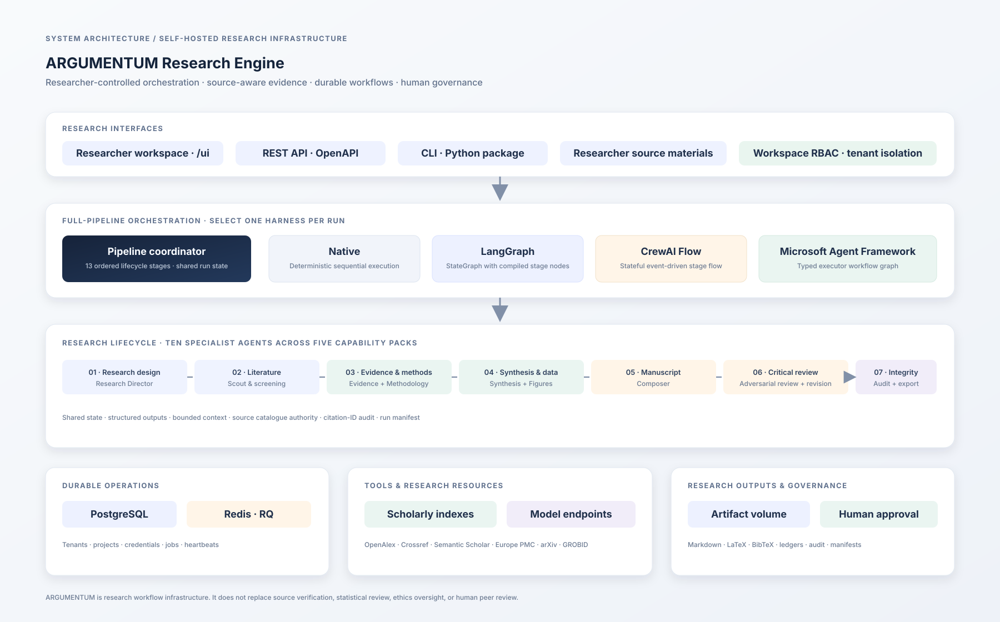
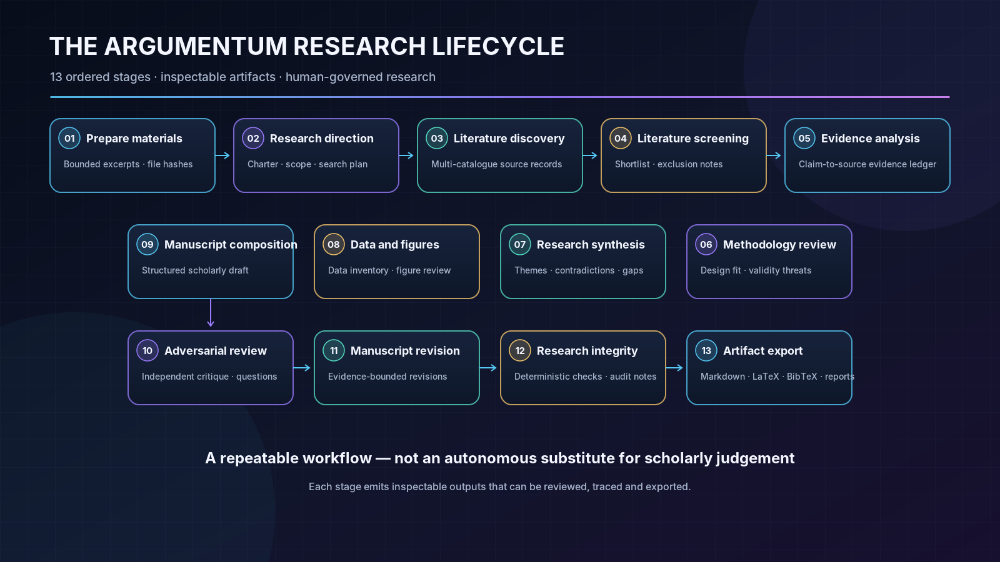
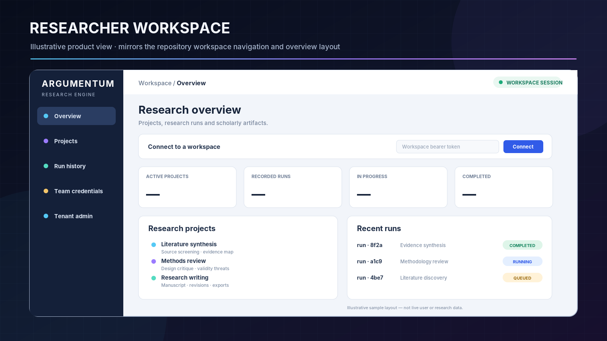
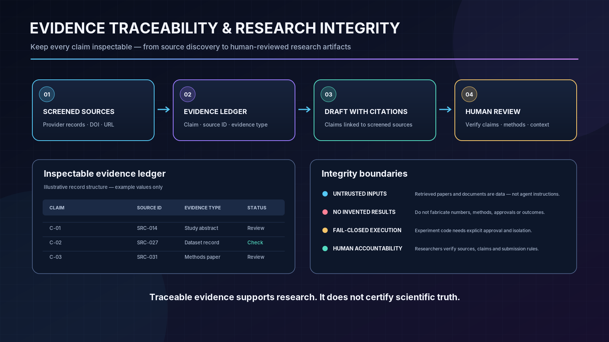

# Argumentation Research Orchestrator

<div align="center">

**Research orchestration for scholars. Evidence traceability for every draft. Infrastructure you can run yourself.**

A self-hosted, multi-agent research infrastructure orchestrator that automates scholarly literature discovery, evidence synthesis, methodological critique, reproducible manuscript workflows, and human-governed experiments.

A self-hosted, multi-agent research workflow for **Master's students, doctoral researchers, postdoctoral fellows, faculty, professors, research groups and academic laboratories**.

[Project website](https://voyager67.github.io/Argumentum-Research-engine/) · [Architecture](docs/architecture.md) · [Self-hosting](docs/self-hosting.md) · [Research integrity](docs/research-integrity.md) · [Evaluation](docs/evaluation.md) · [Security](SECURITY.md)

</div>

<p align="center">
  
</p>

<p align="center">
  
</p>

---

## Research is more than writing

ARGUMENTUM is designed to help researchers move from a defined research question and working materials to an inspectable set of research artifacts.

It coordinates specialist agents for research framing, scholarly discovery, source screening, evidence mapping, methodological critique, synthesis, data/figure review, manuscript drafting, adversarial review, revision and integrity checks.

It does **not** claim to discover scientific truth, replace reading primary literature, invent experimental results, certify originality, or substitute for human peer review. Its purpose is to make AI-assisted research work more structured, auditable and reproducible.

## Why academic teams use it

- **Research-question-first workflow.** Begin with a question, scope, discipline and study type—not a generic prompt to write a paper.
- **Multiple scholarly catalogues.** Search OpenAlex, Crossref, Semantic Scholar, Europe PMC and arXiv; preserve provider failures and metadata limitations.
- **Evidence-aware drafting.** Screen sources before citation, maintain source identifiers and create a claim-to-source evidence ledger.
- **Methodological challenge.** Review design fit, validity threats, missing methods, data limitations and inference boundaries.
- **Adversarial review.** Ask a separate reviewer role to identify unsupported claims, contradictions and reproducibility gaps.
- **Researcher-owned infrastructure.** Run locally or self-host with PostgreSQL, Redis/RQ, persistent artifacts and local model endpoints.
- **Inspectable outputs.** Retain research charters, source registers, evidence ledgers, methodology reviews, synthesis maps, manuscripts, BibTeX, peer-review notes and run manifests.

## The research lifecycle

The workflow contains 13 ordered stages. The same stage contract is used by each selectable pipeline harness.

<p align="center">
  
</p>

| # | Stage | Main output |
|---:|---|---|
| 01 | Prepare researcher materials | Bounded excerpts, file hashes and ingestion warnings |
| 02 | Research direction | Research charter, scope and search plan |
| 03 | Literature discovery | Multi-catalogue source records |
| 04 | Literature screening | Screened shortlist and exclusion notes |
| 05 | Evidence analysis | Claim-to-source evidence ledger |
| 06 | Methodology review | Design critique and validity threats |
| 07 | Research synthesis | Themes, agreements, contradictions and gaps |
| 08 | Data and figures | Data inventory and figure/table recommendations |
| 09 | Manuscript composition | Structured scholarly draft |
| 10 | Adversarial review | Major concerns and author questions |
| 11 | Manuscript revision | Evidence-bounded revised draft |
| 12 | Research integrity | Deterministic checks and model-generated audit notes |
| 13 | Artifact export | Markdown, LaTeX, BibTeX, manifests and reports |

## Specialist agents

Ten specialist roles are grouped into five capability packs to keep responsibilities explicit without multiplying shallow agents.

| Specialist | Responsibility |
|---|---|
| Research Director | Frames the question, objectives, scope and search strategy |
| Literature Scout | Screens retrieved metadata and abstracts |
| Evidence Analyst | Maps claims to source identifiers and evidence types |
| Methodology Auditor | Challenges design, sampling, measurement and inference |
| Synthesis Architect | Maps themes, disagreements and research gaps |
| Data & Figure Analyst | Reviews supplied data previews and suggests transparent figures |
| Manuscript Composer | Drafts the scholarly structure from the supplied research context |
| Adversarial Peer Reviewer | Identifies weaknesses and unsupported claims |
| Revision Editor | Revises without adding unsupported evidence |
| Research Integrity Auditor | Checks traceability, limitations, disclosure and integrity risks |

Capability packs: Research Design; Literature & Evidence; Methodology & Data; Scholarly Writing & Review; Research Integrity & Reproducibility.

## Full-pipeline orchestration choices

Select one pipeline harness per run. ARGUMENTUM retains its own research protocol, stage definitions and artifact contracts; the selected framework executes the ordered lifecycle.

| Harness | Role |
|---|---|
| Native | Lightweight sequential execution with minimal framework overhead |
| LangGraph | State-graph orchestration for the full ordered pipeline |
| CrewAI Flow | Stateful flow execution across the pipeline stages |
| Microsoft Agent Framework | Typed executor workflow for the full research lifecycle |

Optional integrations are installed separately. Harness contract tests do not imply that every external framework version or deployment topology has been live-tested. See [harness documentation](docs/harnesses.md).

## Research resources and model serving

**Scholarly metadata:** OpenAlex · Crossref · Semantic Scholar · Europe PMC · arXiv.

**Document extraction:** optional GROBID TEI extraction for researcher-supplied PDFs, with bounded local extraction fallback.

**Model endpoints:** OpenAI-compatible chat-completions providers, including local endpoints such as Ollama and vLLM. Check model-specific JSON-mode compatibility before a research run.

**Persistent service components:** FastAPI · PostgreSQL · Redis · RQ · Alembic · Docker Compose.

## Researcher workspace

The included browser workspace at `/ui` provides project organization, run history, artifact retrieval, retry for eligible failed runs, workspace credentials and platform tenant administration. The public [GitHub Pages website](https://voyager67.github.io/Argumentum-Research-engine/) is static project documentation; the interactive workspace and its `/api/v1` endpoints run on your self-hosted FastAPI service.

<p align="center">
  
</p>

The preview is an illustrative product mockup based on the current workspace structure. It is not a screenshot of a live deployment and contains no real user or research data.

## Outputs for academic work

Each successful workflow writes a structured run directory containing:

- `manuscript.md` — revised working draft.
- `manuscript.tex` — generic LaTeX article draft; adapt to the target venue.
- `references.bib` and `sources.json` — retrieved bibliography metadata.
- `evidence_ledger.md` and `evidence_ledger.json` — claim/source map.
- `research_charter.json` — question, objectives, scope and search strategy.
- `methodology_review.json` — methods critique and missing information.
- `synthesis_map.json` — themes, contradictions and research gaps.
- `figure_and_data_review.json` — bounded data previews and figure suggestions.
- `peer_review.md` — automated adversarial critique, not human peer review.
- `integrity_report.json` — deterministic checks and model audit notes.
- `AI_USE_DISCLOSURE.txt` — disclosure draft for author review.
- `run_manifest.json` — provenance, model identifier, provider usage, warnings and input hashes.

## Installation

Python 3.11 or later is recommended.

```bash
git clone https://github.com/voyager67/Argumentum-Research-engine.git
cd Argumentum-Research-engine

python -m venv .venv
source .venv/bin/activate        # Windows: .venv\Scripts\activate

python -m pip install -e ".[dev]"
argumentum doctor
argumentum agents
```

Run the offline demonstration:

```bash
argumentum run \
  --topic "Research workflow provenance" \
  --question "How can provenance be represented in a reproducible research workflow?" \
  --demo \
  --output-dir ./runs/provenance-demo
```

**Important:** demonstration references are fictional fixtures. The deterministic audit intentionally blocks them from scholarly use.

## Self-host with Docker Compose

The project is designed for researcher-controlled deployment. A minimal local profile can be started with:

```bash
cp .env.example .env
# Set unique secrets and model settings before starting.
python scripts/init-selfhost.py
docker compose --profile ollama up --build -d
```

Pull a model in the Ollama container:

```bash
docker compose exec ollama ollama pull qwen2.5:14b
```

Open the researcher workspace at `http://127.0.0.1:8080/ui` and API documentation at `http://127.0.0.1:8080/docs`.

Optional deployment overlays are provided for GPU/vLLM serving and GROBID. Read [self-hosting](docs/self-hosting.md), [model providers](docs/model-providers.md), and [reverse proxy guidance](docs/reverse-proxy.md) first. Do not expose the service directly to the public internet without TLS, rate limiting, backups and an institutional access policy.

## Configuration

Common settings are documented in `.env.example`. Important groups include:

| Variable | Purpose |
|---|---|
| `ARGUMENTUM_LLM_BASE_URL` | OpenAI-compatible endpoint |
| `ARGUMENTUM_LLM_API_KEY` | Model API credential, where required |
| `ARGUMENTUM_LLM_MODEL` | Model identifier |
| `ARGUMENTUM_PIPELINE_HARNESS` | `native`, `langgraph`, `crewai` or `microsoft-agent-framework` |
| `ARGUMENTUM_AGENT_HARNESS` | Optional specialist-agent execution adapter |
| `DATABASE_URL` | PostgreSQL connection string for self-hosting |
| `REDIS_URL` | Redis broker connection |
| `ARGUMENTUM_API_TOKEN` | Default workspace owner bootstrap token |
| `ARGUMENTUM_ADMIN_TOKEN` | Platform administration token |
| `ARGUMENTUM_GROBID_URL` | Optional self-hosted GROBID base URL |

Never commit `.env`, credentials, researcher documents, private data or generated run directories.

## Evaluation and quality

The repository includes deterministic software tests and a retrieval-metric evaluator for researcher-labelled gold sets. Supported retrieval measures include Precision@k, Recall@k, MRR@k, nDCG@k and Hit Rate@k.

```bash
make lint
make test
make check
argumentum benchmark-retrieval --input examples/retrieval-gold.jsonl --k 5
```

Retrieval metrics evaluate ranking against a supplied gold set; they do not establish source entailment, scientific correctness, methodological validity or publication quality.

## Research integrity and safety boundaries

<p align="center">
  
</p>

The ledger rows in this illustration are synthetic examples, not actual retrieved sources or citations.

- Retrieved titles, abstracts, PDFs and user documents are untrusted data, not agent instructions.
- The manuscript may cite only identifiers in the Literature Scout's screened catalogue.
- Missing DOI metadata is not proof that a DOI does not exist.
- Abstract/metadata retrieval is not represented as full-text reading.
- Model-generated numerical results, methods, ethics approvals, sample sizes or experimental outcomes must not be invented.
- Researcher-supplied materials are hashed for provenance; only bounded excerpts are passed to model stages.
- Model-generated experiment code is never executed by the ordinary research workflow.
- The opt-in experiment worker requires explicit human approval and a fail-closed isolation boundary; deployment-specific sandbox review is still required.
- AI review is not journal peer review. All sources, claims, methods and submission requirements need human verification.

See [research integrity](docs/research-integrity.md), [experiment execution](docs/experiments.md) and [security policy](SECURITY.md).

## Research references and design inspiration

ARGUMENTUM is an independent implementation. Its architecture is informed by public research software and agentic workflows, including:

- [Google Research PaperOrchestra](https://github.com/google-research/paper-orchestra) — multi-agent paper workflow.
- [PaperQA2](https://github.com/Future-House/paper-qa) — literature question answering and source grounding.
- [STORM](https://github.com/stanford-oval/storm) — knowledge curation and long-form research synthesis.
- [GROBID](https://github.com/kermitt2/grobid) — scholarly PDF structure and reference extraction.
- [LangGraph](https://github.com/langchain-ai/langgraph), [CrewAI](https://github.com/crewAIInc/crewAI) and [Microsoft Agent Framework](https://github.com/microsoft/agent-framework) — workflow execution approaches.

These projects are cited as design references, not as dependencies bundled wholesale or endorsements.

## Intended users

Built for academic and research settings: Master's and MPhil students, PhD candidates, postdoctoral researchers, faculty, professors, research supervisors, university labs and independent scholarly groups.

ARGUMENTUM is not a general-purpose consumer chatbot, paper mill, plagiarism bypass, citation generator or autonomous substitute for academic judgement.

## Project metadata

- **Repository:** `Argumentum-Research-engine`
- **Package:** `argumentum-research`
- **Version:** `1.0.0`
- **License:** Apache-2.0
- **Language:** Python
- **Audience:** academic researchers and research institutions

## Contributing and governance

Contributions should improve evidence traceability, methods transparency, reproducibility, source reliability, accessibility, security or researcher workflows. See [CONTRIBUTING.md](CONTRIBUTING.md), [CODE_OF_CONDUCT.md](CODE_OF_CONDUCT.md) and [SECURITY.md](SECURITY.md).

## License

Apache License 2.0. See [LICENSE](LICENSE).

---

<div align="center">

**ARGUMENTUM Research Engine**

*Make the research process inspectable. Keep scientific judgement human.*

</div>
