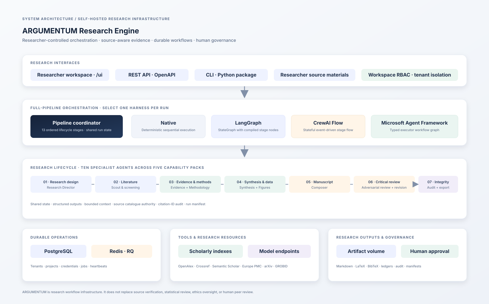
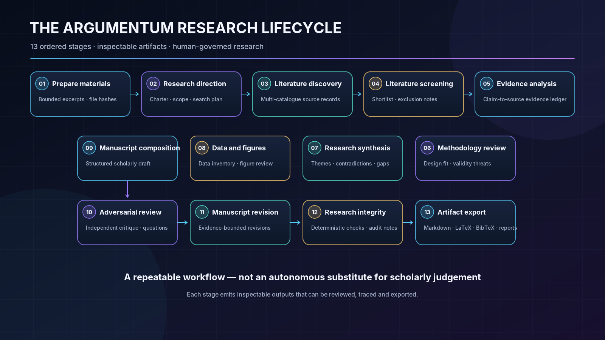

# Architecture and design decisions

  

## System boundary

Argumentum is a researcher-controlled research workflow with ten specialist roles, five capability packs, read-only scholarly metadata adapters, optional self-hosted GROBID PDF extraction, and a self-hosted service mode. The research protocol is an explicit 13-stage sequence. The selected pipeline harness owns the complete stage graph: Native, LangGraph, CrewAI Flow, or Microsoft Agent Framework. It does not claim autonomous scientific discovery, systematic-review completeness, full-text crawling, automatic statistical inference, plagiarism detection, or publication certification.

## Pipeline stages

  

The same thirteen ordered stages are represented in every full-pipeline harness:

1. **Prepare materials** — validate and hash researcher-supplied materials, extract bounded text, and build the run context.
2. **Research Director** — frame the question, scope, objectives, assumptions, and initial search queries.
3. **Discovery adapters** — query OpenAlex, Crossref, Semantic Scholar, Europe PMC, and arXiv; normalize records and preserve partial provider failures as warnings.
4. **Literature Scout** — screen the source catalogue and record an explicit citable shortlist. Unselected records remain in the discovery record, not the manuscript bibliography.
5. **Evidence Analyst** — map claims to source IDs, evidence types, and explicit limitations.
6. **Methodology Auditor** — identify design weaknesses, inference boundaries, and missing methodological details.
7. **Synthesis Architect** — organize themes, agreements, contradictions, and research gaps.
8. **Data & Figure Analyst** — inspect bounded CSV previews and recommend figures; it does not silently execute statistical analysis.
9. **Manuscript Composer** — draft a source-aware structured manuscript.
10. **Adversarial Peer Reviewer** — produce a critical review record.
11. **Revision Editor** — revise without adding sources or unsupported methods/results.
12. **Research Integrity Auditor** — create a model-assisted integrity review; deterministic checks separately validate citation IDs, catalogue membership, demo use, and evidence-ledger IDs.
13. **Artifact Export** — write the manuscript, bibliography, evidence ledger, peer review, integrity report, run summary, and reproducibility manifest.

The stages are intentionally sequential because later research decisions depend on earlier outputs. All four harnesses preserve this order; none currently enables independent parallel literature fan-out or dynamic stage delegation.

## Full-pipeline harnesses

`src/argumentum/workflows.py` provides four **whole-workflow** implementations. Each receives the same ordered `PipelineStage` objects and shared run state: Native executes them sequentially; LangGraph builds one compiled `StateGraph` with a node for every stage; CrewAI Flow builds one state-carrying Flow with ordered listeners; and Microsoft Agent Framework builds one executor graph and passes the run state through its workflow context. `src/argumentum/harnesses.py` additionally retains optional per-agent invocation adapters. The pipeline harness is selected independently using `ARGUMENTUM_PIPELINE_HARNESS` or the CLI `--harness` option. See [Full-pipeline harnesses](harnesses.md) for details and compatibility boundaries.

## Five capability packs, ten agents

The public capability taxonomy groups related work into five packs: Research Design; Literature & Evidence; Methodology & Data; Scholarly Writing & Review; Research Integrity & Reproducibility. Internally, role contracts remain more granular so each task is constrained and testable.

## Self-hosted services and tenants

The optional service stack is FastAPI + PostgreSQL + Redis/RQ + a background worker + a periodic reconciler. Research job records are tenant-owned; bearer-token digests, workspace identities, and role checks are stored in PostgreSQL. Artifacts and uploaded inputs live in a private persistent volume. The browser workspace includes project CRUD/archive, project-associated run submission, run history and filtering, retries, artifact retrieval, workspace credential lifecycle, and a platform tenant-administration view. It is a practical research operations UI rather than a full institutional identity-management or enterprise administration suite.

Platform administration and workspace identity are separate. The platform administrator can create/list/disable tenants. Workspace owner/admin/researcher/viewer credentials have distinct permissions, and jobs/artifacts are queried by tenant. This is API-token RBAC, not password identity or SSO. PostgreSQL row-level security is not configured; tenant isolation is enforced at the API layer.

## Optional experiment runner

The optional experiment queue is separate from the research pipeline. It accepts short Python source only from owner/admin credentials with an explicit `human_approved: true` confirmation. A separate single-replica Compose worker uses a no-network container and bubblewrap namespaces, resource limits, and a filesystem view that does not mount the service data volume into the untrusted child process. If isolation is unavailable, execution is blocked. It does not execute model-generated code automatically, and the current environment has not validated the sandbox on a Docker/Linux host.

## Data model and traceability

`Paper` stores a run-local source ID and provider metadata. IDs are assigned after deduplication and sorting and are not permanent across runs. DOI is the preferred deduplication key; a conservative normalized title/year/first-author key is used only when DOI is absent.

`InputDocument` records a relative path, SHA-256 digest, file size, and extracted text. The run manifest stores path, hash, and size, not original file bytes. Model context uses a second bounded budget; material outside the budget remains hashed but is not sent to model stages. PDF/DOCX extraction has page, archive-expansion, member-count, and text limits. CSV previews are bounded. The researcher remains responsible for protecting output and input volumes.

`AgentResult` records role, status, timestamps, elapsed time, and structured output. The LLM provider records token counts only when the endpoint includes usage metadata.

## Provider contract

The model adapter sends JSON-mode chat-completion requests to `<base_url>/chat/completions`. This small interface supports compatible hosted or local endpoints. Provider-specific extensions, tool calling, and vendor-specific response APIs are outside the current scope.

The model is not assumed to be deterministic. The manifest captures configuration that is safe to disclose, but not raw prompt content, secrets, or full model responses outside stage artifacts. Users should secure the whole run directory where sensitive content exists.

## Security and reliability decisions

- Core dependencies are zero; optional PDF/DOCX readers and service dependencies are installed through extras.
- Input traversal, multipart bodies, per-file size, aggregate size, and model context are bounded.
- Output directories must be empty; the application refuses to overwrite existing work.
- API calls are read-only for literature discovery and bounded by timeouts/retries.
- Documents and retrieval content are framed as untrusted data in model prompts.
- Model-generated code is never automatically executed. The separate experiment queue requires human approval and an isolated worker.
- No shell, browser, arbitrary plugin, or filesystem tools are exposed to research agents.
- Job/tenant authorization and artifact access are enforced by the API. The database is not tenant-RLS protected.
- The deterministic audit is conservative and cannot infer semantic citation support.

## Trade-offs and limitations

| Decision | Benefit | Cost / limitation |
|---|---|---|
| Sequential research pipeline | Simple provenance and reviewable stage artifacts. | More serial model requests and latency/cost. |
| Five read-only discovery catalogues | Broader coverage across general metadata, biomedical literature, and preprints. | Not exhaustive; abstracts/metadata and ranking/rate limits vary. |
| Optional GROBID service | Structured title/abstract/body/reference extraction from supplied PDFs. | Adds a sizeable service; extraction quality varies and references require verification. |
| PostgreSQL/Redis/RQ with reconciler | Durable run state, off-request execution, bounded retries, recovery. | At-least-once queue semantics require idempotent design; backups and monitoring are operator responsibilities. |
| Tenant API-token RBAC | Workspace boundaries and revocable individual credentials. | No SSO, MFA, passwords, SCIM, database RLS, or automatic tenant quotas. |
| Full-pipeline harness adapters | Allows the complete 13-stage lifecycle to be executed by a selectable framework while preserving one research protocol. | Framework-specific durable checkpoints are not wired to the RQ recovery protocol; retries can restart from stage one. Optional package versions require live integration testing. |
| Human-approved sandbox queue | Supports small deterministic computations without exposing the main service data or network. | Linux namespace support required; no formal sandbox certification or arbitrary dependency installation. |
| Abstract/metadata-based screening | Fast, low-friction literature triage. | Not a systematic full-text review. |
| Deterministic citation audit | Catches unknown IDs and broken ledger references. | Does not prove that a paper supports the claim. |
| CSV preview only | Avoids pretending ingestion is statistical analysis. | Researchers still need a verified analysis pipeline and reproducible scripts. |
| Generic LaTeX export | Editable article-class TeX with embedded references and separate BibTeX. | Not a publisher template; adapt and validate against venue rules. |

## Licensing and research provenance

Argumentum is independently written and does not copy PaperOrchestra source files. Related public systems are linked in the README for research context. Referenced APIs and projects keep their own licenses and terms; review provider policies before institutional or commercial use.
