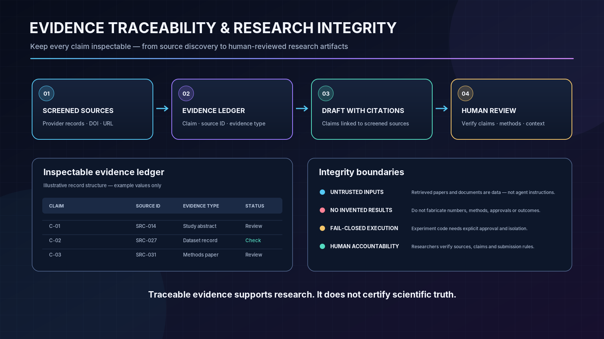

# Research integrity, provenance, and limitations

  

The ledger rows shown are synthetic examples for illustration; they are not retrieved papers or real citations.

## Intended use

Argumentum helps organize the early and middle stages of a research workflow. It can propose questions, search phrases, a literature shortlist, an evidence map, methodological questions, a manuscript structure, and critical review questions. Every output is provisional.

## Evidence categories

The evidence ledger asks the model to distinguish empirical, theoretical, review, metadata-only, and illustrative records. These are descriptive labels, not a validated evidence hierarchy. A model-generated qualitative label is not a calibrated probability, certainty score, or formal GRADE assessment.

A record with only title, year, venue, DOI, or an abstract must never be described as a full-text appraisal. The user must open and read each primary paper and confirm that the particular statement is supported in context.

## Citation checks

The deterministic audit verifies that recognized in-text IDs resolve to the run's source catalogue and that evidence-ledger source IDs belong to the catalogue. It cannot determine whether a source supports a sentence, whether a result was replicated or retracted, whether study populations/methods match the inference, whether important contradictory research was omitted, or whether bibliographic details are correct.

## Human responsibilities before academic use

1. Retrieve the full text of every source and check material claims against it.
2. Update search strategies, inclusion/exclusion criteria, screening logs, and search dates to match the actual protocol.
3. Independently check whether the search is comprehensive for the discipline and required databases.
4. Verify research design, sampling, instruments, preregistration, statistical analysis, uncertainty reporting, and reproducibility.
5. Address ethics review, consent, privacy, data protection, conflicts of interest, funding, and data availability.
6. Verify references and the target venue's formatting and AI-use disclosure policy.
7. Obtain appropriate supervisor, co-author, statistician, librarian, or domain-expert review.

## AI authorship and disclosure

The application creates a draft AI-use disclosure as a starting point. Authors must describe the actual model(s), provider, dates, tasks, human review, and contribution where required by institutional, funder, publisher, or conference policy. Do not present generated prose, analysis, or hypotheses as work independently performed by a human. Follow current venue policies.

## Synthetic demo records

`--demo` uses fictional fixtures with `.invalid` URLs and `DEMO-###` identifiers. These records are for software demonstration only. A demo run is deterministically marked **BLOCKED**. Never cite them or treat them as empirical examples.

## No fabricated results

If no experimental results are supplied, the system should state that results are unavailable or use a placeholder. It must not invent sample sizes, p-values, confidence intervals, datasets, ethics approvals, or findings. The retrieval metric utility calculates ranking metrics only on researcher-labelled input. No scientific-quality benchmark or measured accuracy improvement is claimed by this repository.

## Privacy and retention

The software does not persist API keys to run manifests. However, a hosted model endpoint receives the content included in each request, and generated artifacts and uploaded inputs are written to local storage. Do not send personally identifiable, confidential, unpublished, commercially sensitive, export-controlled, or otherwise restricted material to an external provider without approval. Check provider retention/training policies, institutional agreements, and local law.

## Experiment execution boundary

Model-generated code is **not automatically executed**. The optional API experiment route accepts a separate researcher-submitted Python snippet only from workspace owners/admins and requires the explicit `human_approved: true` request field. Execution is handled by a separate single-replica no-network container with bubblewrap namespace isolation and resource limits. If bubblewrap or host namespace support is unavailable, the runner fails closed.

This isolation has not been security-certified, and its behavior depends on the host Linux kernel and container runtime. Do not expose it as a public arbitrary-code service or submit code whose effects you have not reviewed. See [Human-approved experiment execution](experiments.md).

## Reporting an issue

For security concerns, follow [`SECURITY.md`](../SECURITY.md). For research quality issues, include the relevant non-sensitive stage artifact, a minimal reproduction, and whether the problem is model-dependent or reproducible in offline demo mode.
